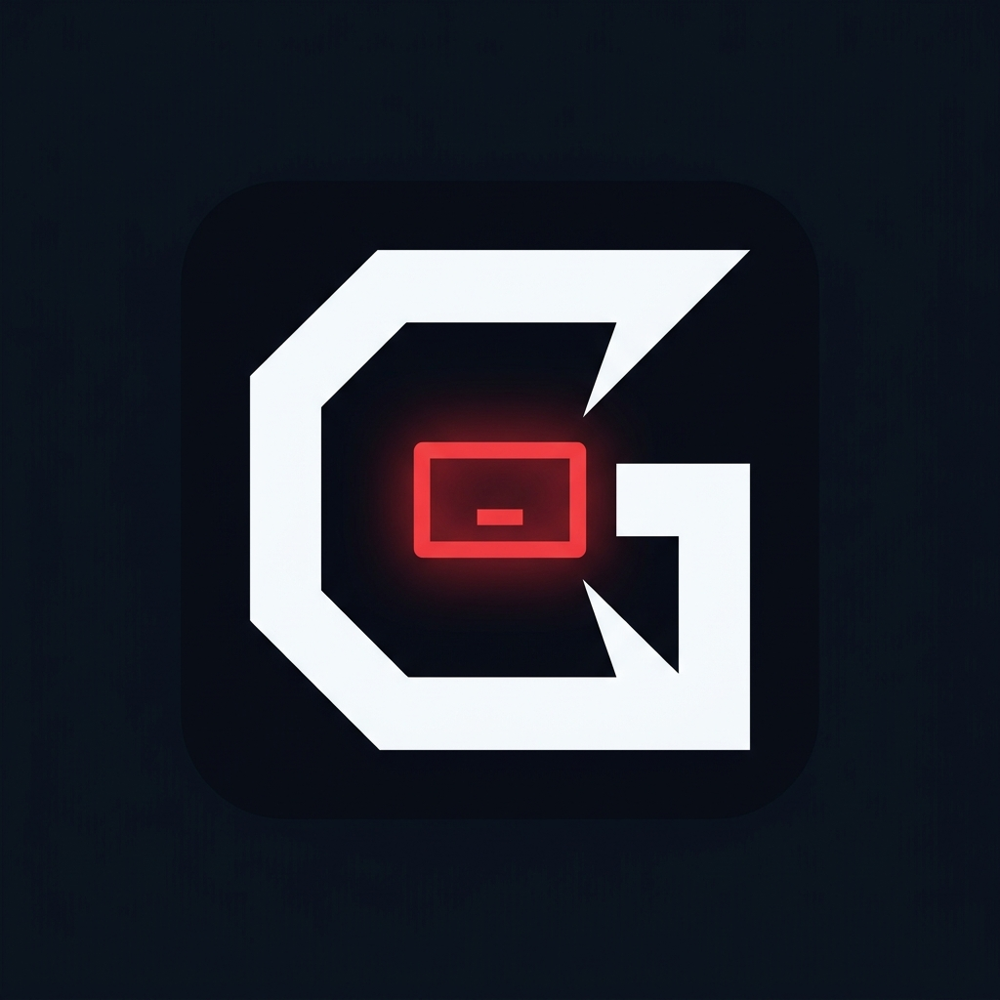

<div align="center">



# Gluttony Web

[](https://opensource.org/licenses/MIT)
[](https://svelte.dev)
[](https://vite.dev)
[](#design-system)

<p align="center">
The official showcase and promotion website for <strong>Gluttony</strong> — the high-precision, lean engineering protocol for autonomous AI agents.
</p>

</div>

---

## Overview

A dark power-tool cockpit landing page built with **Svelte 5** and **Vite**, engineered to promote Gluttony and its 4 canonical sub-skills:
- `gluttony`: Core lean software engineering & YAGNI enforcement.
- `gluttony-refactor`: Behavior-preserving structural restructuring with 4-phase verification bracketing.
- `gluttony-audit`: Strictly read-only bloat hunter and redundant dependency scanner.
- `gluttony-ui`: High-precision web interface hygiene and WCAG AA accessibility.

---

## Design System: Raycast Style

Faithfully implements the **Raycast midnight command center** design language:
- **Canvas:** Void Black (`#040506`), 98% achromatic canvas with subtle elevation steps (`#07080a`, `#111214`).
- **Brand Accent:** Single warm Coral Pulse (`#ff6363`) used exclusively for logo diamond, active badges, and hero atmospheric geometry.
- **Actions:** Neutral Mist (`#e6e6e6`) filled buttons with Iron (`#454647`) text.
- **Card Treatment:** Tactile 'Keyboard Key' shadow stack (`rgba(255,255,255,0.05)` inset top highlight + `rgba(255,255,255,0.22)` outer ring + `rgba(0,0,0,0.2)` inset bottom).
- **Typography:** Inter (with signature regular weight `400` at `56px` headline) and Geist Mono for code/terminal metadata.
- **Interactive Features:**
  - **Raycast Command Center Mockup:** Live tabbed prompt runner and copyable commands for `/gluttony`, `/gluttony-refactor`, `/gluttony-audit`, and `/gluttony-ui`.
  - **Empirical Benchmark Dashboard:** Visualized comparative metrics (diff size, prompt weight, regressions).
  - **Live WCAG AA Contrast Verifier:** Interactive mathematically accurate contrast calculator ported from `script/contrast.js`.
  - **Universal Platform Grid:** Copyable install commands across 14+ agent harnesses and IDEs.

---

## Development & Build

### Prerequisites
- Node.js $\ge$ 18 (Tested on v24)
- npm $\ge$ 9

### Install Dependencies
```bash
npm install
```

### Run Local Dev Server
```bash
npm run dev
```

### Build for Production
```bash
npm run build
```

The production output will be generated in `dist/`.

### Preview Production Build
```bash
npm run preview
```

---

## License

MIT License. Copyright (c) 2026 [Novazeb](https://github.com/Novazeb).
